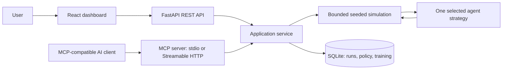
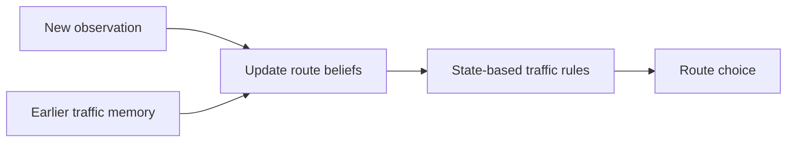
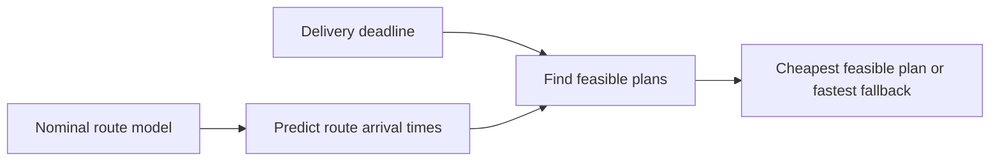
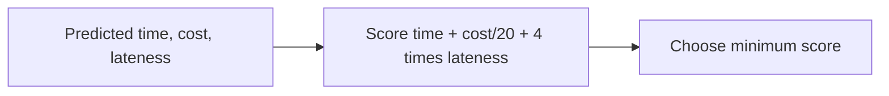
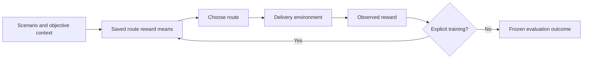
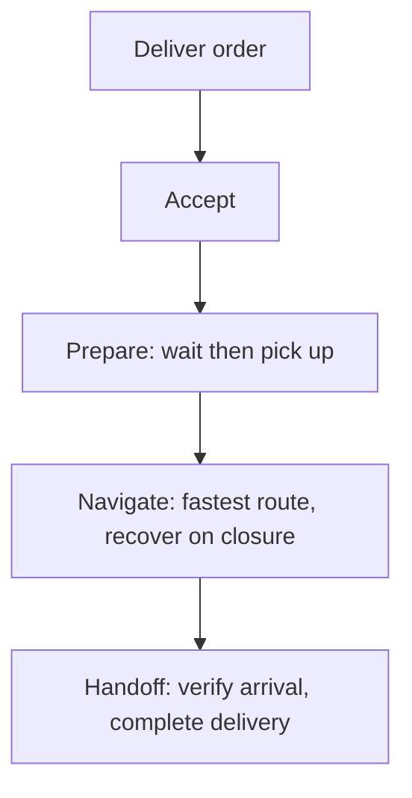

# Architecture

The API and MCP tools call the same service, avoiding divergent simulation logic. The frontend uses API responses for every metric, trace, table, and chart. Map playback replays saved events and never mutates a run. Native Python code executes simulations; an LLM is needed only in an external AI client for conversational control.

## Policy diagrams

### Simple Reflex

### Model-Based Reflex

### Goal-Based

### Utility-Based

### Learning

### Hierarchical

## Contracts and persistence

Input models reject unknown fields, invalid agent/scenario IDs, negative seeds, invalid deadlines, and unbounded training requests. Responses contain run IDs, configuration, metrics, trace entries, and the policy snapshot used. Trace entries include action, modeled time, lifecycle state, current route/progress, reason, and architecture evidence. MCP summary tools omit bulky traces; `get_run` retrieves the complete trace.

SQLite tables: `runs(id, created_at, batch_id, agent_id, scenario_id, payload)`, `policy(context, route, samples, mean)`, `training(id, created_at, payload)`. JSON payloads preserve the exact configuration and results. Training acquires a writer transaction before reading and updating the policy. Comparisons capture one policy snapshot and use identical pre-generated exogenous route draws for each independent agent.
